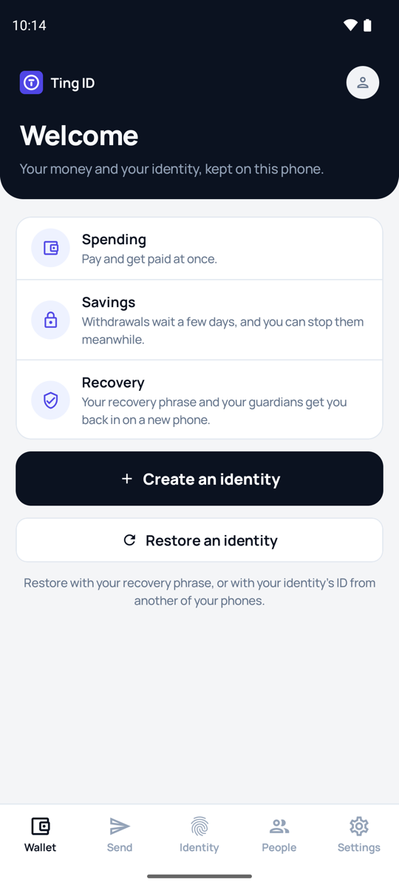
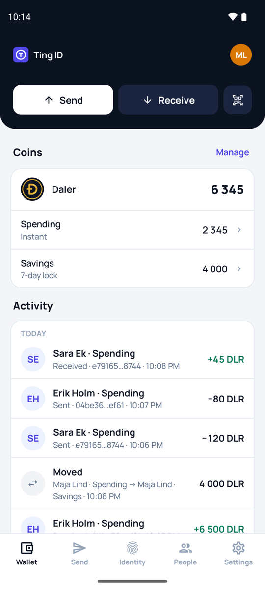
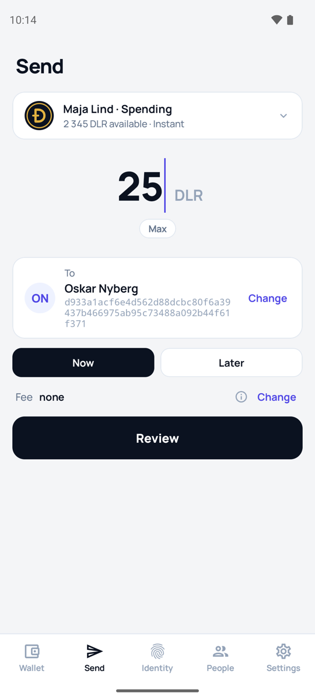
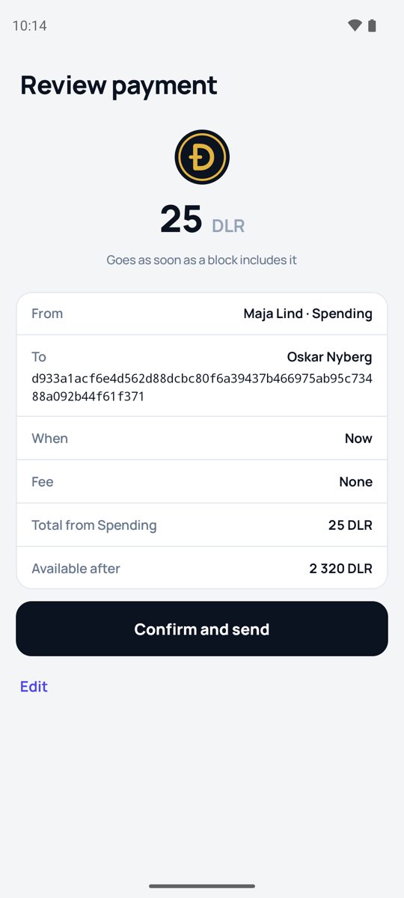
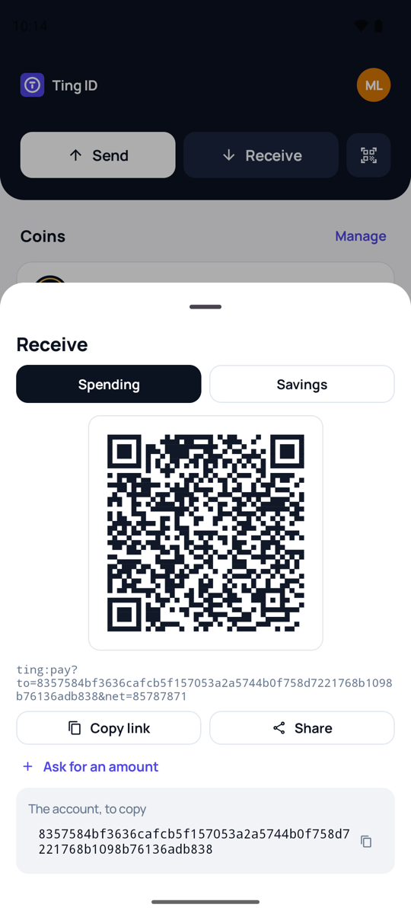
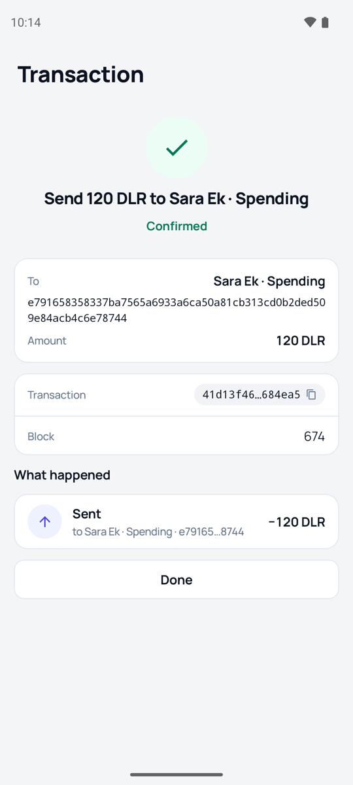
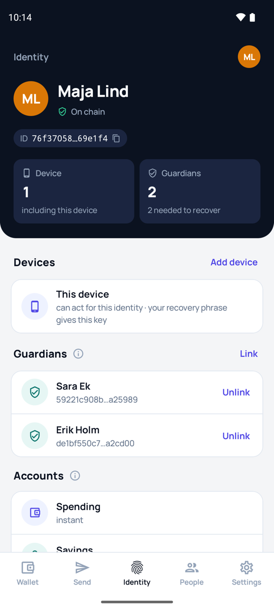
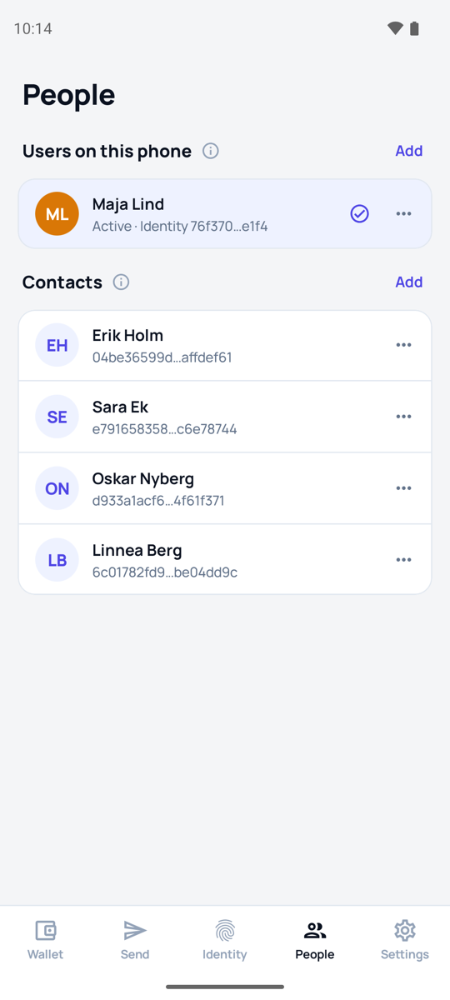

# Ting ID

Ting ID is a wallet and identity app for Android, for the
[Ting](https://github.com/ting-organization/ting) network.

<table>
  <tr>
    <td align="center"><br>Welcome</td>
    <td align="center"><br>Wallet</td>
    <td align="center"><br>Send</td>
    <td align="center"><br>Review</td>
  </tr>
  <tr>
    <td align="center"><br>Receive</td>
    <td align="center"><br>Transaction</td>
    <td align="center"><br>Identity</td>
    <td align="center"><br>People</td>
  </tr>
</table>

The pictures are of a [development chain](#a-development-chain) with test
identities.

## Download

`Ting-ID.apk` is on the [releases page](https://github.com/ting-organization/ting-id/releases).

> **Early builds.** Ting ID is new software and still changing. It can have
> faults that cost you coins: keep in it only what you can afford to lose. It
> comes without warranty (see the licenses).

Open `Ting-ID.apk` on the phone and allow your browser to install apps. If Play
Protect offers to scan an app it does not know, let it, then choose Install
anyway. Every release is signed with the same certificate, whose SHA-256
fingerprint is in the release notes; an update installs over the app and keeps
its keys, while uninstalling the app deletes them.

Each release lists the files' SHA-256 in `SHA256SUMS`, and
`gh attestation verify Ting-ID.apk --repo ting-organization/ting-id` shows that
the file was built by this repository's release workflow.

## What it does

- A user is an identity: a spending account, a savings account whose payments
  wait seven days and can be cancelled meanwhile, devices that can act for it,
  a recovery phrase of twelve words, and guardians who can restore access and
  replace a phrase someone else got hold of. [RECOVERY.md](RECOVERY.md)
  describes the phrase.
- It sends, schedules and cancels payments in any coin of the standard coin
  program, with fees set from what recent transactions paid.
- Phones ask things of each other with Ting links, as QR codes or text: pay me,
  set up my identity and send me my first coins, add this device, approve my
  recovery. [LINKS.md](LINKS.md) describes them.
- With Settings → Coin tools on, a Coins tab lists every coin on the chain,
  creates coins, and mints coins whose minter is one of your accounts.
- Sites can ask it to sign in or to sign a statement, with Ting Off-Chain
  Signing: [TOCS-1](TOCS-1.md) is the protocol, for sites and other wallets.

Keys are made on the phone and sealed by its keystore, in its secure hardware
where it has some; the written recovery phrase is their only copy outside it. The app reads the chain through
one or more nodes and checks every record against the block it comes from;
with two or more nodes, each checks the others.

## Build and run

Ting ID is a native Android app in Kotlin with Jetpack Compose. You need JDK
21 or newer (Android Studio's own will do) and the Android SDK with platform
37; Gradle comes with the repository (`./gradlew`).

```bash
./gradlew :app:assembleDebug         # the app, in app/build/outputs/apk/debug
./gradlew :app:installDebug          # onto a connected phone or a running emulator
```

Android 11 or newer is needed. The debug build installs beside the release
one, as an app of its own with its own keys. A build of your own starts with
the production nodes, `https://node1.ting-node.com` and
`https://node2.ting-node.com`, which check each other; `TING_NODES`
(comma-separated addresses) names others when the app is built. A node of
your own, set up with [`ting init`](https://github.com/ting-organization/ting#readme)
and `ting api enable`, is added in Settings → Nodes. Plain http works only for
the phone itself and the home network.

### A development chain

`scripts/dev-chain.sh` sets up a chain of your own to try the app on: a node
made with `ting init --dev`, listening on 127.0.0.1 only, with the reference
programs deployed where the app looks for them and Daler deployed as on the
production network. It then tells you how to build the app for that node.

```bash
scripts/dev-chain.sh ../ting/target/release/ting ~/ting-dev
```

Blocks come from `ting mine --data-dir ~/ting-dev`. Run by
[ting-miner](https://github.com/ting-organization/ting-miner)'s `ting`
instead, the node also claims Daler's block reward for the account set with
`ting miner payout <account>`, such as one from Receive in the app; without
it, Settings → Coin tools creates a coin and gives it to your accounts. A fee
of none is enough on this chain, since its blocks take transactions that pay
nothing.

## Test

```bash
./gradlew :core:test                 # the core's tests, on the JVM
./gradlew :core:test -Pting.live     # with the production nodes, over the network
./gradlew :app:connectedDebugAndroidTest   # the vault and the phrase code, on a phone or emulator
./gradlew :app:lintDebug
```

`core/src/test/resources/vectors.json` holds byte vectors from a Rust
implementation of the same formats; the tests check that the app produces
exactly those bytes. `proof-fixture.json` is a storage answer with its proofs,
taken from a node, for the proof checks. The recovery phrase code is checked
against the published BIP-39 and BIP-32 vectors, on the JVM and on the phone.
[`docs/tocs-1-vectors.json`](docs/tocs-1-vectors.json) are the off-chain
signing vectors every implementation of [TOCS-1](TOCS-1.md) should pass.

| Path | Contents |
|---|---|
| `core/src/main/kotlin/app/tingid/chain/` | Byte formats, hashing, keys and recovery phrases, accounts, coin, identity, fees, transactions, proofs, links, off-chain signing, the node client and the node pool |
| `core/src/main/kotlin/app/tingid/state/` | Saved state, the chain cache, what the app reads from the nodes and submits to them |
| `core/src/main/kotlin/app/tingid/text/` | What the app says about activity, requests, nodes and coins |
| `core/src/main/resources/app/tingid/chain/` | The BIP-39 word list and the reference programs (`contracts/*.wasm`) |
| `app/src/main/kotlin/app/tingid/vault/` | The keystore vault for keys and recovery phrases, the owner check |
| `app/src/main/kotlin/app/tingid/ui/` | Theme, components and screens |
| `assets/logo/` | The Ting ID mark, from which the app icon's layers are drawn |

The reference programs are copied from the Ting repository's `programs`
folder with `scripts/sync-contracts.sh <path of the ting repository>`; the app
derives their ContractIds on any chain from them, and the tests check their
code hashes.

## Releases

A version tag (`v1.2.3`) runs the [release workflow](.github/workflows/release.yml).
It builds the app at that version, signs it with the release key, which needs
approval, and creates a draft release to look over and publish. The repository
variable `TING_NODES` (comma-separated https addresses) names the nodes a new
installation starts with.

## License

Licensed under either of [Apache License, Version 2.0](LICENSE-APACHE) or
[MIT license](LICENSE-MIT), at your option. The font and the libraries the app ships
with are listed in [THIRD_PARTY_NOTICES.md](THIRD_PARTY_NOTICES.md).
Security issues: see [SECURITY.md](SECURITY.md).
